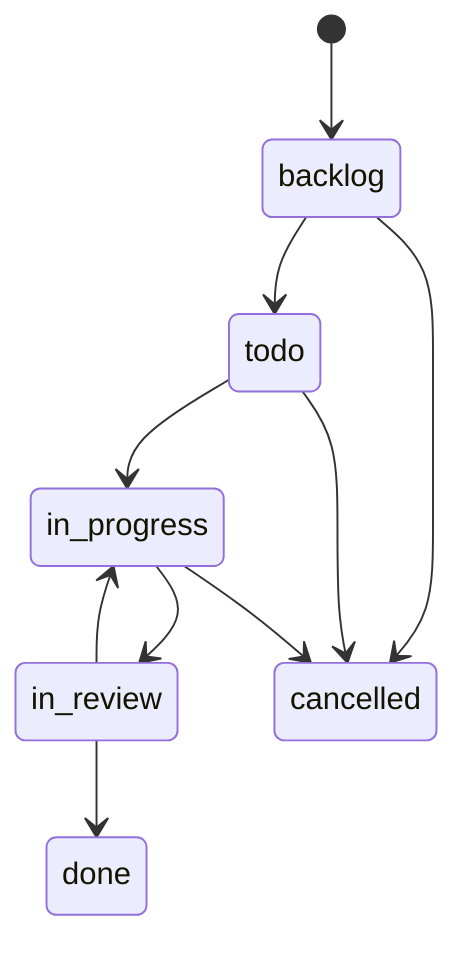
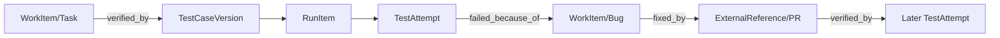

# DDD 领域模型与不变量

> **状态**：Phase 2 WorkItem / Phase 4 Testing 的主要不变量已在 Go Domain + PostgreSQL 约束与集成测试实现。下文仍包括后续扩展提案，实际持久化以迁移和 Go 包为准。见 [PRD](../product/prd.md) 与 [数据模型](data-model.md)。

## 1. 通用语言

- `Principal`：操作主体，`human | agent | integration`；不表示是否正在运行。
- `Actor`：一次命令的已认证 Principal，写入审计。
- `Assignee`：工作项当前处理责任的 Principal（可为 Agent）；`AccountableOwner` 可为最终审核负责的 Human。
- `WorkItem`：Task/Bug 的统一工作对象，带类型、状态与稳定编号。
- `Workflow`：项目允许的状态及转换，状态字面值不是业务代码的唯一依据。
- `TestCase`：可编辑的用例身份与草稿；`TestCaseVersion`：一次发布的不可变内容。
- `TestRun`：**外部/人工测试结果的记录容器**；`RunItem`：绑定特定 CaseVersion；`TestAttempt`：一次执行上报（事实追加）。
- `Artifact`：来自对象存储的附件元数据与内容哈希；`ExternalReference`：外部系统事实链接。
- `Activity`：面向用户的活动流；`AuditRecord`：不可随意变更的操作审计。

## 2. Context 与聚合

### Identity & Access
- 聚合：Principal、Credential、Membership、RoleBinding。
- 规则：token 只能代表一个 Active Principal；token 权限不高于其主体 Membership/Scope；撤销后立即拒绝新请求；审计同时保留主体和凭证 ID（不记录 secret）。

### Workspace
- 聚合：Workspace、Project、WorkflowDefinition。
- 规则：项目 Key 在 Workspace 内唯一；同一项目的工作项只使用其生效 Workflow；删除优先软删除/归档，不能破坏历史关联。

### Work Management
- 聚合：WorkItem（含可选 BugDetails）；Comment、Dependency/Relation 可独立聚合以避免无界集合。
- WorkItem：`id`、`project_id`、`key`、`type`、`title`、`description`、`acceptance_criteria`、`status`、`priority`、`assignee_principal_id`、`accountable_owner_id`、`version`、`created_at`、`updated_at`。
- BugDetails：`severity`、`steps_to_reproduce`、`expected_behavior`、`actual_behavior`、`environment`；仅 `type=bug` 可持有。
- Comment：追加作者/来源/内容/时间，编辑需保留修订记录；外部报告不可伪装为人类评论。
- Dependency：禁止自环与重复有向边；创建阻塞依赖时校验闭环，避免循环导致永久不可领取。
- 业务动作：`CreateWorkItem`、`UpdateWorkItem`、`ClaimWorkItem`、`TransitionWorkItem`、`AddComment`、`LinkDependency`、`CreateBugFromFailedAttempt`。

### Testing（Phase 4 已实现核心）
- 聚合：TestCase（包含草稿与版本发布操作）、TestRun（包含 RunItem 清单的有限元数据）；TestAttempt 独立追加写入。
- `TestCaseVersion` 发布后不可编辑或删除原内容；包含标题、前置条件、步骤、预期结果、测试数据的快照和 checksum。
- `TestSuite` 是集合组织而非执行结果。
- `TestRun` 记录来源 Principal、外部 run ID、environment/build/commit、创建时间；不是执行器实例。RunItem 固定版本和 checksum，Phase 4 不含测试进程的开始/结束生命周期。
- `RunItem` 绑定 `test_case_version_id` 与快照 hash；关联 Case 身份、可选外部 case ID。
- `TestAttempt` = RunItem + attempt_no + result(status/pass/fail/blocked/skipped) + observed_at + reported_by + provenance + evidence；**追加不可覆盖**。
- 业务动作：`PublishTestCaseVersion`、`CreateTestRun`、`RecordTestAttempt`、`LinkFailureToBug`。

### Evidence & Archive
- 聚合：ArtifactMetadata、ArchiveExport；AuditRecord/Activity 为追加事实。
- Artifact 必须明确 Workspace/Project/主体、内容 hash、size、media type 与关联对象，不能公开可猜测的裸对象存储路径。
- AuditRecord 保留 actor、credential ref、action、entity、before/after 摘要、request_id、version、时间；不可透传秘密。
- ExportSnapshot 记录 scope、创建人、生成时间、文件清单/校验值、完成状态与保留策略。

### Integration
- 聚合：WebhookSubscription、DeliveryAttempt、ExternalReference。
- 不直接写业务表，通过 Application Service 进行交叉上下文业务动作；Webhook/Outbox 属于事件投递，不是 Agent 编排。

## 3. 关键不变量

**W1：状态合法性。** WorkItem 只能按照所属项目的 Workflow 边转换；可选权限保护 `in_review → done`，不能绕过统一 App Service。

**W2：并发。** 同时 Claim 的条件更新只有一个成功；版本不匹配返回 conflict；若重试同一幂等键返回第一次结果（不是新动作）。

**W3：身份分离。** `actor_principal_id` 不自动覆盖 `assignee` 或 `accountable_owner`；Agent 使用的 token 不允许冒充 Human。

**T1：用例版本稳定。** TestRun 的 RunItem 必须指向创建时固定的 CaseVersion，不跟随 Case 当前版本漂移。

**T2：结果不可抹除。** 每次 TestAttempt 必须追加，重复幂等请求不插入新的 Attempt；最后状态通过最新 Attempt 的读投影计算，历史保留。

**T3：失败与缺陷多对多。** 失败 Attempt 可无 Bug；Bug 可关联多个 Attempt；“失败”不等于一定产生 Bug，也不因后续 Passed 被删除。

**E1：证据来源。** `reported_by` 与 `observed_at` 单独记录；Qual 对外部上报的“通过”记录其来源，不声称自行复验。

**E2：审计保留。** 所有业务写入必须带 Actor 与 RequestID，并在事务内写审计；界面活动只是可读投影。

**X1：租户/项目边界。** 任意跨 Context 引用的资源必须验证位于授权 Workspace/Project，不能通过猜 UUID 越权。

## 4. 状态机初版

项目状态列表初期预置，后续才开放完全自定义工作流。**初版 `is_blocked` 只根据阻塞依赖/标记派生，不作为额外状态列**；若后续需要显式 `blocked` 状态，另行评审 Workflow 迁移。

状态迁移与权限列表应写入配置数据（即使默认只有一份），并以测试固定默认行为。`done` 允许后续 `reopen` 命令创建审计与新版本，不在 MVP 中要求任意到任意状态的跳转。

## 5. 关联图（逻辑，不代表一张宽表）

应用层协调多 Context 的关联写入，数据库用明确的 linking table；不允许任意类型的 link 组合而不做约束。

## 6. 跨领域事件（事件名供初版设计）

`WorkItemCreated`、`WorkItemClaimed`、`WorkItemTransitioned`、`TestCaseVersionPublished`、`TestAttemptRecorded`、`BugLinkedToFailure`、`ArtifactAttached`。领域事件首先用于事务性审计/Outbox，不表示要引入全量 Event Sourcing 或运行时事件总线。

## 7. 待实施时拆解的独立业务用例

以 `Command + Result + Domain Error` 设计。命令要带 `ActorContext`、`expected_version`、`idempotency_key`（按需），查询应有 Project 限制与 cursor。未经允许的动作必须返回明确错误，不返回静默成功。
