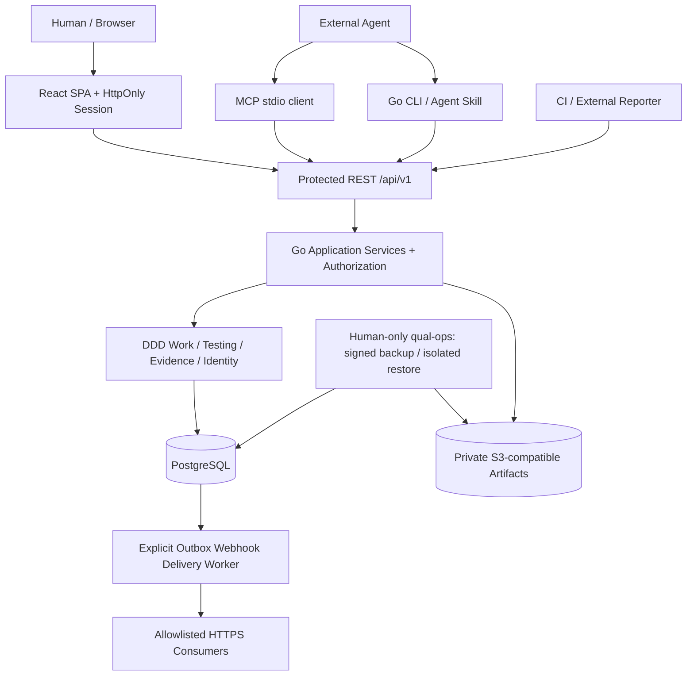

# 系统架构总览

> **Phase 6 本机硬化已实现**：Go `identity`/`work`/`testing`/`evidence` DDD、REST/PG/Audit、Session、任务/测试/证据/归档 UI、CLI/MCP stdio、私有 S3 Artifact、显式 Webhook Worker、PG/S3 签名备份与隔离恢复、就绪/运维指标。正式远程 MCP OAuth、项目 ZIP 跨实例恢复导入、生产 OIDC/TLS/HA 及真实团队试点尚未完成。参考 [ADR-0001](../decisions/0001-product-boundary.md) 与 [ADR-0002](../decisions/0002-modular-monolith.md)。

## 1. 架构原则

- **业务一致性优先**：人类 Web、Agent MCP、CLI、Integration REST 使用同一 Application Service 与授权策略。
- **外部 Agent 是客户端**：Qual 不持有 Agent Runtime，不调度执行；支持人类与 Agent 对同一工作项进行受控写入。
- **模块化单体先行**：一套 Go 服务、一个 PostgreSQL 事务域，限界上下文之间使用显式接口与 ID，不直接依赖对方的 persistence。
- **可替换 Adapter**：REST、MCP、DB、对象存储、Webhook 是外围组件，Domain 不感知协议。
- **可追溯**：变更、测试结果与证据具有来源、Actor、时间、不可变版本；同事务保存必要审计与 Outbox。
- **简化运营**：MVP 不依赖消息总线、分布式事务、独立搜索引擎或向量数据库。

## 2. 架构图



Phase 8 授权策略先根据 Credential Scope、Project Membership 与 Project Override + Role Defaults 统一判断，不因 Actor 是 Human/Agent 而限制普通审核、审计、导出或 Webhook 能力；只有管理权转授仍由 Human Workspace Admin 明确授权。权限修改同事务写 Audit/Outbox。

`Web` 不是独立写后端状态的入口。React 通过 HttpOnly Session、CSRF 与生成 TypeScript SDK 调用受保护 REST；Go CLI/外部 stdio MCP 通过独立 Agent PAT 调用 REST，后者统一交给 `identity` 身份策略、`work/application` 用例和 PostgreSQL 适配。**外部 Agent 宿主不能直接持有数据库管理员凭证**。正式远程 HTTP MCP OAuth 尚未实施。

**不在图中画 Agent orchestration**：它由用户选择的外部宿主完成，与 Qual 部署无关。

## 3. 模块归属

| Context | Go 逻辑目录 | 责任 |
| --- | --- | --- |
| Identity & Access | `internal/identity` | Phase 8：Principal、credential scope、project role + 逐成员 Allow/Deny/Inherit、不可变授权审计、Human/Agent 统一权限 |
| Workspace | `internal/workspace` | Workspace、Project、Workflow 定义 |
| Work Management | `internal/work` | Phase 2 已实现：WorkItem、BugDetails、Comment、Dependency |
| Testing | `internal/testing` | Phase 4 已实现：Case/Version、Suite、Run/RunItem、追加 Attempt、JUnit、失败关联 Bug |
| Evidence & Archive | `internal/evidence` | Phase 5 已实现私有 S3 Artifact、ExternalReference、授权快照 JSONL/ZIP/Manifest、维护日志 |
| Integration | `internal/integration` | 候选 Stage C stdio MCP 34 Tools（当前 PI 已注册的运行中仍28）、Webhook Subscription 加密密钥、HMAC/SSRF 安全投递与持久化 Delivery；不包含执行器 |

`internal/platform` 放数据库事务、日志、时钟、ID、配置、HTTP 基础设施（Phase 6 readiness + 低基数 metrics）；`internal/operations/backup` 仅运维命令可调用签名 PG/S3 备份/隔离恢复。不得把运维恢复权限下发给 Agent，也不得把平台包变成业务万能层。跨领域读模型由应用层组合，写入通过明确服务接口协调。

## 4. Go 包组织草案

```text
apps/server/
  cmd/
    server/main.go
    qual/main.go
  internal/
    work/
      domain/
      application/
      infrastructure/postgres/
      transport/http/
      transport/mcp/
    testing/...
    identity/...
    workspace/...
    evidence/...
    integration/...
    platform/
  migrations/
  go.mod
```

**当前 Go module 暂为 `qual`（本地路径占位）**，因为仓库尚未设置正式远端地址。确定托管路径后以独立提交调整 Module path。初期一个 Go module 足够，不因为 Monorepo 自动引入 go.work。

## 5. 前端与 Monorepo

`apps/web`：React + TypeScript + Vite + React Router Data Mode + Tailwind CSS + shadcn/ui。以 `features/work`、`features/tests`、`features/defects` 等组织状态与 UI；跨功能通用组件放 `components`，只有两处以上真正复用再提取到 `packages/ui`（当前不创建该包）。

React Router 管深链接与导航、TanStack Query 管服务器缓存；Loader 可以预热 Query Cache，避免两个缓存系统各自重复请求。TS SDK 根据 `packages/contracts` 的 OpenAPI 生成。前端所有授权只作 UX 提示，服务端必须重新判定。

根仓库使用 pnpm workspace 仅管理 JS/TS；Go 编译与迁移可用 Make/Taskfile 后续封装。首版部署目标：Go 单进程 HTTP + 独立 PostgreSQL + S3 兼容存储（本地开发为 SeaweedFS），前端产物交给反向代理或 Go 静态服务（部署前 ADR 决定）。目前仅 Docker 开发依赖，不是生产部署拓扑。

## 6. 一次写入的数据流

1. HTTP/MCP Handler 校验输入格式、token 与请求元信息。
2. Application Service 获得 Actor/Workspace/Project；判定作用域、策略、状态转移权限。
3. 加载聚合并验证 version、不变量；必要时原子 SQL 更新避免竞态。
4. 在一个 DB transaction 内写业务状态 + Activity/Audit + Outbox。
5. 返回更新后的资源、版本、RequestID；Outbox Worker 后续异步投递 Webhook。
6. 失败要么整体回滚，要么返回结构化冲突/验证错误；外部发送失败不能撤销已提交的业务状态。

外部附件通过受授权的上传流程存对象存储，DB 写元数据、hash 与归属；对象存储本身不支持 DB 原子事务，需要准备/完成状态与失败清理流程。

## 7. 读写与可靠性策略

- PostgreSQL 为唯一权威业务状态；搜索从关系索引和全文索引开始。
- Cursor 分页适用于评论、审计、测试 Attempt、活动等长列表。
- WorkItem 使用单调增长 `version`，HTTP `ETag` / `If-Match` 映射；CLI 和 MCP 显式发送 expected_version。
- 重试写采用有作用域的 Idempotency Key；重复请求必须返回同一逻辑结果，禁止重复产生测试 Attempt。
- 数据库 Outbox 用租约和指数退避完成 Webhook 投递，事件消费端需能处理至少一次投递。
- 时间使用 UTC 存储并在客户端本地化展示；ID 使用 UUID，稳定显示编号与底层 ID 分离。
- 对复杂图关系做限制与索引，不要一次载入整个工作空间依赖图。

## 8. 非功能目标（设计门禁而非已实现事实）

- 关键写入无丢失更新、可审计、支持重试。
- 租户隔离和权限校验覆盖 REST/MCP/附件与导出。
- 可在本地 Docker 环境自部署，并提供备份/恢复文档。
- 健康检查、结构化日志、OpenTelemetry Trace、请求 ID。
- 关键路径需具备并发测试及集成测试；性能指标在试点数据基础上决定，不在文档中捏造 SLA。

## 9. 外部参考

- https://github.com/modelcontextprotocol/go-sdk
- https://reactrouter.com/start/modes
- https://ui.shadcn.com/docs/installation/vite
- https://docs.sqlc.dev/
