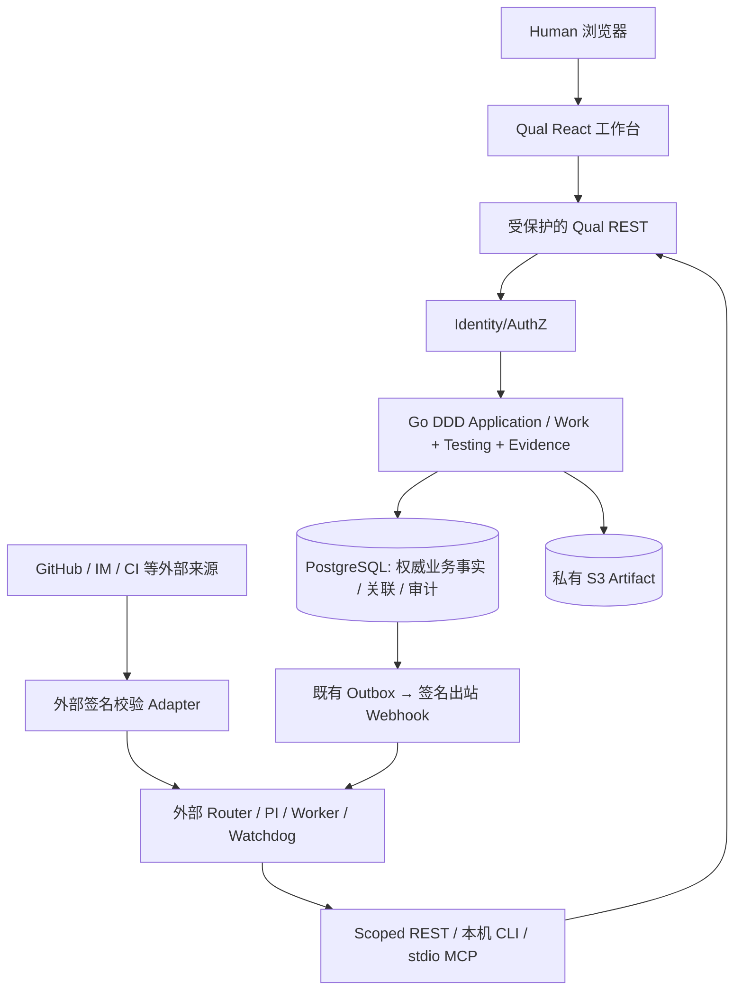

# Qual × Super-agent 分期协作契约 v0

> **状态：QUAL-26 设计基线，2026-11-03。以下“候选接口、字段、表、Scope、示例”均未实现、未加入线上 OpenAPI、未迁移默认数据库。** 仅现状盘点是已实现事实。生效的运行时契约仍是 [`packages/contracts/openapi.yaml`](../../packages/contracts/openapi.yaml) 和当前 CLI/MCP；每个实施项须先将自己负责的部分正式纳入 OpenAPI、生成 SDK、迁移/测试并单独验收。决策见 [ADR-0025](../decisions/0025-qual-superagent-collaboration-boundary.md)。

## 1. 目标、约束与架构

`QUAL-26` 定义“可恢复的外部执行，持久可信的 Qual 工作事实”。目标是让一个真实 PI Agent 或未来多个真实 Agent 在**会话重开**后，从工作项版本、真实依赖、关联测试、审核决定与证据恢复进展，让外部 Trigger/Thread/Run 有稳定来源关联，并只把需要处理的情况显示给 Human。



- **外部宿主执行**：监听事件、Router 路由、进程启动/停止/调度、模型推理、真实测试/CI、心跳上报、Watchdog/恢复。
- **Qual 只存、查、验、审、投递**：工作项/测试/证据/授权/验收，新增候选 ExternalThread/Event/AgentRun **事实投影**，以及需要关注事项的授权只读组合。`work_item_claim` 永不触发进程。
- **唯一权威**：WorkItem `done` 只能由显式完成门禁写入；TestAttempt `passed` 只能由真实外部测试上报的合法测试用例写入。AgentRun `succeeded` 与 Watchdog 报告不等于以上任何一个状态。

## 2. 现有实现逐项盘点（不是候选能力）

| 现有能力 | 已有依据 | 复用与未解决的缺口 |
| --- | --- | --- |
| WorkItem/无环阻塞/Claim/版本 | [WorkItem 领域](../../apps/server/internal/work/domain/work_item.go)、[`/dependencies` OpenAPI](../../packages/contracts/openapi.yaml) | 保留 CAS 与业务状态；不创建新的任务事实源 |
| MCP `work_item_get_context` | [MCP 实现](../../apps/server/internal/integration/mcpserver/server.go)、[REST 组合](../../apps/server/internal/integration/mcpserver/remote.go) | 当前 `schema_version=1`、`context_revision=WorkItem.version`，包含 WorkItem、最多10条评论和依赖；**不是**完整测试/审核/证据上下文，也非跨实体原子快照 |
| 测试/证据 | [Testing 契约](../../packages/contracts/openapi.yaml)、[Evidence 领域](../../apps/server/internal/evidence/domain/evidence.go) | 已有 TestRun/不可变 Attempt、Ready Artifact 与 SHA、独立读取权限，不建影子 Passed 字段 |
| ExternalReference | [`00007_evidence_archive.sql`](../../apps/server/migrations/00007_evidence_archive.sql) | 已有 `project_id,provider,kind,external_id,url,target_kind,target_id`；HTTPS URL 必须合法，且 `UNIQUE(project_id,provider,kind,external_id)` 只能归属一个目标；**不支持现成的多 WorkItem Thread 链接** |
| ReviewQueue/Done Gate | [ADR-0020](../decisions/0020-review-queue-work-visibility.md)、[ADR-0022](../decisions/0022-explicit-done-gate-owner-acceptance.md) | 真实 Reviewer `needs_work`、再提交、Owner 自审风险、强制独立审核保留；Attention 只扩展读投影 |
| Audit/Activity/Outbox | [`00003_work.sql`](../../apps/server/migrations/00003_work.sql)、[ADR-0005](../decisions/0005-audit-and-outbox.md) | 业务写事务一致；已有 Outbox 是服务器**向外**投递，不能直接当作第三方入站消息存储 |
| 人机授权 | [ADR-0015](../decisions/0015-human-agent-project-permissions.md) | 已有 Project Membership + Credential Scope + Allow/Deny/Inherit；任何新 Scope 不会自动进入旧 Agent PAT |

## 3. 统一名词与业务不变量

| 概念 | 身份与有效范围 | 语义与唯一真相 |
| --- | --- | --- |
| `WorkItem` | `project_id + work_item_id + version` | 已有 Task/Bug、优先级、状态、阻塞依赖、审核策略 |
| `ContextBundle`（候选只读 DTO） | `project_id + work_item_id`，`schema_version` | 从各领域**按权限**组合的摘要，不持久化聊天 Session；每节有 `observed_at`/来源/游标 |
| `ExternalThread`（候选事实） | `project_id + provider + thread_kind + external_thread_id` | 一条 PR/Issue/IM thread/外部 Run 讨论等，可链接多个 WorkItem；不伪造外链 |
| `WorkThreadLink`（候选事实） | `project_id + thread_id + work_item_id` | 多对多显式关联、真实创建者与时戳；不替换既有 ExternalReference |
| `ExternalEvent`（候选事实） | `project_id + provider + external_event_id` | 第三方已验证后由受权 Adapter 上报，带 `thread_id`、`event_type`、事件发生/入库时间、摘要/哈希；事件体不授予权限 |
| `AgentRun`（候选报告） | `project_id + source + external_run_id` | **外部**执行报告；关联一个真实 WorkItem 和真实报告 Principal，Source ID 不等于 AuthN Actor |
| `AgentRunReport`（候选追加历史） | `agent_run_id + source_report_id` | 外部报告的阶段、声明结果、错误引用、时间，保持历史，不回填业务 Done |
| `AttentionEntry`（候选只读派生） | `source_type + source_id + reason_code` | Reviewer 真实待决策、AgentRun 真实外部阻塞/失联等；不是新 WorkItem 或第二套 Review 状态 |
| `AutonomyPolicy`（P2 可选） | `project_id + policy_version + authorized_actor` | 授权来源与外部自动化范围；默认 Observe，不可提升实时能力 |

**硬规则**：外部可声明的 `principal_name`/`external_actor_id`/`status` 是**数据**。Qual 审计 Actor/Credential、审核独立性、测试真实性、审核策略、是否允许 Done，均必须由服务端鉴权与领域事实计算。不同 `Principal` 才可能构成真正独立审核；同一 Principal 多职责仍为自审。

## 4. 候选 API / MCP / CLI 表（均非线上接口）

以下路由是**后续实施任务的设计输入**，不是 2026-11-03 已部署的 API；具体路径一旦落地须先通过 `packages/contracts/openapi.yaml` 的兼容审查与 SDK 生成。所有路径均以 `/api/v1/projects/{projectID}` 开头。

| 阶段与工作项 | 建议方法 / 路径（后缀） | 用途与权限草案 |
| --- | --- | --- |
| P0 QUAL-27 | `GET /work-items/{itemID}/context?section=...&limit=...&cursor=...` | Implemented only in isolated feature branch: one section/request, work:read plus per-section test/artifact read permission; raw Audit excluded |
| P0 QUAL-28 | 原 `work_item_get_context` 扩充响应 + `qual context ...` | 复用现有 MCP 工具；旧字段继续兼容，增加有界继续读取 |
| P0 QUAL-29 | `POST /work-items/{itemID}/threads`、`GET /work-items/{itemID}/threads`、`GET /threads/{threadID}/work-items` | 真正多目标显式关联；写 `work:write`、读 `work:read`；受控去重和 CAS |
| P0 QUAL-30 | `POST /external-events`、`GET /work-items/{itemID}/external-events`、`GET /threads/{threadID}/external-events` | 已验证 Adapter 上报 / 按游标读取，写新 `event:write`（待实现、默认无权），读 `work:read` |
| P1 QUAL-32 | `POST /agent-runs`、`POST /agent-runs/{runID}/reports`、`GET /work-items/{itemID}/agent-runs` | 外部运行登记、追加状态与有界查询；写新 `run:report`（待实现、默认无权），读 `work:read` |
| P1 QUAL-34 | `GET /attention?limit=...&cursor=...` | 授权的派生注意力列表，拒绝越权关联 |
| P1 QUAL-31/33/35 | 现有详情/协作审核 UI 与生成 SDK | 读前述真实接口；禁止隐性“自动通过” |
| P1 QUAL-36/37 | PI/外部 Adapter / E2E 契约 | 外部执行与恢复，**不新增 Qual 启动器** |
| P2 QUAL-38 | 外部 Watchdog 从上述读接口读取 | 定期检查在外部；提醒只能通过受权事件登记 |
| P2 QUAL-39/40 | 先形成策略 ADR，再设计受权策略读取/变更 | 默认 Observe / Disabled；启用 Auto 必须经有权 Human 审批 |

**最小 Go 组织建议**：WorkItem/Review/依赖仍在 `internal/work`；TestRun/Attempt 在 `internal/testing`；Artifact/ExternalReference 仍在 `internal/evidence`；ExternalEvent / AgentRun 可按职责放 `internal/integration` 的新领域子模块，并提供只读关联端口，**不把其模型塞进 WorkItem 聚合**。跨上下文 Context/Attention 由 Application 只读组合服务调用现有授权 Ports；HTTP、MCP、CLI 只是适配器，领域不依赖协议或进程。

**Round 3 F1 fanout operational boundary (2026-11-03, isolated branch only)**: The previous per-RunItem `LIMIT` is not a bound on work when a WorkItem has thousands of qualifying RunItems. The v2 REST `attempts` section now chooses indexed direct reads for at most 32 linked RunItems or materialized project-ordered 512-row candidate batches for wider fanout. Candidates are filtered by exact real WorkItem Coverage before they can be returned; scanning more than 16,384 source candidates without resolving the requested page produces **HTTP 503 `CONTEXT_QUERY_BUDGET`** and no fake partial/successful history. The full scanner remains a read-only derived view, not a new truth store. See the branch's canonical OpenAPI and engineering verification, not the illustrative multi-`sections` JSON below.

**QUAL-27 implementation delta (2026-11-03, isolated branch only)**: The older `sections` / `omitted_sections` multi-section concept and illustrative JSON below are *candidate design*, not the new REST wire shape. The v2 REST implementation chooses a single `section` and returns `items` plus section-specific paging. Unauthorized test/artifact sections return 403 without their private facts. Attempt paging uses `(ingested_at,source_id)` keyset and Goose 00015 join/index migration; Dependency/Coverage relations use composite `source_key`, not an invented row ID. Follow `packages/contracts/openapi.yaml` in the QUAL-27 branch for precise schemas; QUAL-28 remains responsible for compatibility with the existing v1 MCP tool.

## 5. ContextBundle v2 草案

- 保留已有 MCP `schema_version=1` 的 `work_item`、`recent_comments`、`dependencies`、`context_revision` 字段语义；未来新增 REST 可从 v2 起，MCP 新字段须增量兼容，不悄然改变旧调用形状。
- 主要数据按 `work_item.version`、`review_entry_id`、`test_run_id / attempt_id`、`artifact_id / sha256`、`thread_id`、`agent_run_id`、`source_event_id` 指向真实已存在来源。测试历史**不能**只返回“最近 Passed”而丢失旧 Failed。
- 默认只返回小摘要（建议每节默认 20、最大 100，并有 `next_cursor`），详细正文/证据只由现有有权 API 按需展开。`artifact:read` 不存在时不能泄漏文件名、大小、SHA 或下载地址；`audit:read` 不存在时不得跨权带出 Audit。
- `context_revision` 仍定义为 **WorkItem.version**，不能宣称它能捕获所有独立 Test/Event/Run 的变更。返回 `generated_at`、每节 `as_of` 或 `watermark`，`consistency: best_effort`；需要严格一致性的实现另行设计数据库快照，不能由 MCP 逐次读拼装时假称原子快照。
- `sections` 是白名单而非自由 JSON path；`omitted_sections` 可以告知某节未请求或无权，但不能泄漏该节是否包含私密实体。无权时 HTTP status 在主 WorkItem 层按 403/404；分节不足权限时只返回允许内容且按固定原因标注 `not_authorized`（不带数量/名字）。

示意响应（**合成 ID，不代表真实数据**）：

```json
{
  "schema_version": 2,
  "context_revision": 4,
  "project_id": "00000000-0000-4000-8000-000000000001",
  "generated_at": "2026-11-03T00:00:00Z",
  "consistency": "best_effort",
  "work_item": {
    "id": "00000000-0000-4000-8000-000000000002",
    "status": "in_progress",
    "version": 4
  },
  "sections": {
    "review": {"source": "work_role_entries", "latest_entry_id": null, "as_of": "2026-11-03T00:00:00Z"},
    "tests": {"items": [], "next_cursor": null, "as_of": "2026-11-03T00:00:00Z"},
    "artifacts": {"items": [], "next_cursor": null, "as_of": "2026-11-03T00:00:00Z"}
  },
  "omitted_sections": ["audit:not_authorized"]
}
```

响应中 `status` 只是缓存中的真实 WorkItem 值；UI/Agent 执行任何写入前必须重新读当前版本与权限，不以陈旧 ContextSnapshot 直接决策。

## 6. ExternalThread / ExternalEvent 的最小写入契约

### Thread

- 以 `provider+thread_kind+external_thread_id` **在项目内**唯一识别 Thread；来源经过规范化（如 GitHub 仓库坐标、IM workspace/channel）后再做 ID 归一化，不能仅靠聊天标题或不受信任 URL 去重。
- 可以多 Thread 对多 WorkItem；新 `work_thread_links` 提案必须以 Project 联合外键校验两侧并记录 `created_by`、`created_at`。历史 ExternalReference 继续原样保留；允许单个旧引用作为一条已确证的链接来源，但**不批量猜测迁移/虚构 URL**。
- `POST` 必须有 `Idempotency-Key`，提交 `expected_version` 保护目标 WorkItem（是否触碰 WorkItem 版本需在 QUAL-29 以实际事务验证，若触碰即形成新的实质更改影响 Review），相同键同参数重放返回同一关联；不同源身份或相同外部 ID 指向不同内容时拒绝冲突，不静默重定向。
- URL 仅作为被显示的外部引用，继续坚持 HTTPS/无凭据/防危险跳转规则，**Qual 不抓取第三方 URL**。

### Event

建议请求体最小字段（**合成实例，不代表已成功调用**）：

```json
{
  "provider": "github",
  "external_event_id": "delivery-test-001",
  "thread": {
    "thread_kind": "pull_request",
    "external_thread_id": "repository-A/pr/17"
  },
  "event_type": "pull_request.review_submitted",
  "occurred_at": "2026-11-03T00:00:00Z",
  "payload_sha256": "aaaaaaaaaaaaaaaaaaaaaaaaaaaaaaaaaaaaaaaaaaaaaaaaaaaaaaaaaaaaaaaa",
  "summary": "Untrusted external review event received"
}
```

- Adapter **先验证**第三方事件签名与来源，再用自己的 Qual Credential 上报；Qual 不能把请求中 `provider`/`external_actor_id` 当成可信认证主体。未经验证的 webhook 不能转发成有权写请求。
- 至少以 `(project_id,provider,external_event_id)` 加上**一致 payload hash**去重：同事件同内容返回同一 Event；同 ID 异 hash → 409 且原记录保持不变。`Idempotency-Key` 还须保留既有请求级去重约束。建立关联与事件的写入在合法情况下同事务追加审计/活动/Outbox。
- 事件存稳定来源、类型、简短安全摘要、哈希、服务端 `received_at`、第三方 `occurred_at`；不保存 Secret、Cookie、PAT、原始任意 HTML/Prompt、全量敏感消息。重复/乱序事件不得直接改写 WorkItem/Acceptance/Test 的权威状态。
- 仅按 `project_id` 查询，按 `(received_at,id)` 或明确一致的游标排序，禁止拼接未授权 Thread ID 偷看其他项目的事件内容。

## 7. AgentRun 的最小外部报告契约

- 唯一键 `(project_id, source, external_run_id)`；必须关联已存在且同 Project 的 WorkItem，受权认证的真实 `reporter_principal_id` 从服务端生成。`source_status` 只表示外部报告：`queued`、`running`、`blocked`、`succeeded`、`failed`、`cancelled`；投影上的 `stale` / `unknown` 是根据最后报告时间计算的**可观测性状态**，不是新的外部源事实。
- 每份报告由稳定 `source_report_id` 与 digest 幂等去重；未来报告不覆盖历史，乱序的旧 `occurred_at` 不得撤销更新报告。服务端 `received_at`、外部 `occurred_at` 必须分开；异时钟不能作为真实测试通过证据。
- 高频 heartbeat 可只维护受限、非审计级 `last_seen_at` 投影，按阈值采样/聚合；状态变化、错误引用、关联证据等**实质事件**必须追加历史与审计。缺心跳只能说“未知/可能停滞”，不能把 WorkItem 自动 `cancelled/done`。
- 外部 Run 的日志/证据采用真实私有 Artifact/ExternalReference，大小/权限依赖现有机制；禁止将日志正文作为不可受控的大字段写入 WorkItem。
- 不提供 `/agent-runs/{id}/start`、`stop`、`retry`、`worker-pool` 等执行控制接口；Watchdog 的任务执行或重试由宿主完成，Qual 只可存事实。

## 8. Attention Inbox 与政策边界

- QUAL-34/35 必须**复用**当前 [ReviewQueue](../decisions/0020-review-queue-work-visibility.md)：真实 `in_review`、最新 `needs_work`、真正 Reviewer 已核验但待合法关闭；只添加**有来源**的外部 `blocked/needs_input/stale`。每条含 `reason_code`、`source_kind/source_id`、`work_item_id`、`observed_at`、所需能力提示和可导航目标。
- 不是“所有 AgentRun 列表”。先展示影响决策的事项，按稳定排序、去重、游标分页；当前 Project 权限之外的事实不能在计数、过滤器、排序或通知中侧漏。
- QUAL-39 P2 可选 `observe → auto`，策略默认 Observe/Disabled：**策略授权 ≠ 当前有效 API 权限**，每次操作必须重新走 AuthN、Credential Scope、Project Allow/Deny、WorkItem version、Review Policy 和 Done Gate。开启 Auto 应由有权 Human 明示授权并审计，不允许低权 Agent 自授管理权或模拟独立 Reviewer。
- 需求与环境不允许多人时，以真实一个 PI Principal 多职责、自审显式标记的本机试点验证，不制造第二个身份。

## 9. 最小权限、响应码与事件事务矩阵（方案，未部署）

| 操作 | 基础前提 | 不得发生 |
| --- | --- | --- |
| Context 主项读取 | `work:read` + 有权 Project | 无 `audit:read` 读取原始 Audit、无 `artifact:read` 读取私有证据 |
| Context 子项读取 | 在 `work:read` 基础上分别再要求 `test:read` / `artifact:read` / `audit:read` | 聚合接口暗中升级身份能力 |
| Thread 关联写 | `work:write`、同 Project 双侧资源、CAS + 请求幂等 | 跨项目关联、冒充来源、无版本覆盖 |
| Thread / Event 读 | `work:read` 且对应 WorkItem 真正可见 | 通过猜测 Thread ID 读未授权任务 |
| Event 接收 | **新增候选** `event:write`，必须由真实管理员批准、最小受信任 Adapter Credential | 把新 Scope 自动加给旧 PAT；用 `webhook:manage` 代替入站认证 |
| AgentRun 报告 | **新增候选** `run:report`，同 Project/绑定工作项，来源幂等 | 利用报告者身份宣称是 Reviewer/Test Runner/Owner |
| AgentRun 读 / Attention | 对所呈现的工作项逐条 `work:read`，原始 Audit 仍须 `audit:read` | 聚合视图泄漏别的 Project 计数或审计 |
| 真实 Test / Completion | 原有 `test:write`、`work:review`、证据/高风险审核策略 | `succeeded`、Watchdog 或 Policy 直接写 `done` |
| 政策变更（P2） | 明确 Human 管理员授权、政策版本 CAS 和审计 | 任意 Agent 自授 `access:manage` 或修改自身权限 |

**权限兼容重点**：`event:write` / `run:report` 当前**不存在**，只是最小权限设计提案。引入时需扩展 Identity Scope 枚举、角色默认（deny）、OpenAPI/CLI/MCP、数据迁移和授权负面回归；不能借此改变既有 Agent 的 effective permissions。对本机可信 PI 可采用已有明确授权的业务写用例做有限适配试验，但不得把 `work:write` 当第三方 Integration 的通用入站通行证。

**HTTP 约定**：合法首次写入 201 / 业务读 200；合法幂等重放返回已保存结果；`Idempotency-Key` 缺失 428；无认证 401；有效凭证但无 Scope/Project 允许 403；跨 Project 或隐藏对象 404；CAS 失配、同键不同 payload、同 event ID 不同 digest 409；无效字段/状态使用当前 OpenAPI 的 400/422 语义。401/403/404/409 必须拒绝全部业务写入，不留下半条 Event/Run/Audit/Outbox。若需要脱敏兼容处理，须写对应负例回归。

## 10. 兼容迁移、限流、归档与回退

1. **不修改已存在事实**：现有 `external_references` 唯一键和历史 `work_acceptance_decisions`/`work_role_entries`/Attempts 不改写。新增链接必须有确证的项目和来源，绝不根据同名文本自动合并或把已 Done 任务补造审核。
2. **增量 Goose 迁移**：建议单独新增 `external_threads`、`work_thread_links`、`external_events`（P0）和 `agent_runs`、`agent_run_reports`（P1），Project 复合外键/唯一索引；附加导出 JSONL 与快照 `archive_schema_version`；旧 ZIP 只读兼容，跨实例 ZIP 导入仍 Pending。
3. **逐项灰度**：先 OpenAPI/TypeScript SDK 兼容检查，再 Go Domain + application + PG 隔离集成测试，再 CLI/MCP、UI；新接口默认关闭或不可访问直到 migrations 和授权完成。已有 work item / evidence / reviews API 不变。
4. **回退**：关闭新入口、恢复旧 CLI/MCP/前端读取路径；**不**破坏性执行数据库 Down 删除审计/Run/Event/证据；如不能安全 Down，明确拒绝，保留数据并安排 Operator 审查。
5. **保留与节流**：Context 限量摘要且有可继续游标；外部事件按来源设置负载上限、保留策略、重复窗口和低基数指标；Run 高频心跳不产生无界 Audit/Outbox 风暴。具体默认值须在每个实施项中用真实负载验证。
6. **生产安全缺口**：当前 PI 在同一 macOS UID、Human 浏览器仅 loopback、OIDC/TLS/远程 MCP OAuth/生产级 OS 沙箱/HA 未完成。新增对外事件能力不得在解决生产授权/网络隔离前直接公网开放。

## 11. 分任务验收与测试矩阵

| 任务 | 独立正向验收 | 必备负向/恢复路径 | 事实证据 |
| --- | --- | --- | --- |
| QUAL-26（本项） | ADR + 现状复用、候选协议、权限、范围、验收矩阵与回退形成文档；链接可读 | 不更改 OpenAPI、服务端/线上配置，不标后续任务 Done | 文档检查、Git commit 和真实 Qual 履历 |
| QUAL-27 | 受控 REST Context 有界有来源，历史 Attempt/Review/Ready Artifact 可继续读取 | `work:read` 之外子 Scope 不泄漏，分页、跨 Project 404，非原子快照不装成原子 | Go 集成+API 合同 |
| QUAL-28 | 真实 PI CLI/MCP 同 WorkItem 重读且兼容已有工具 | 会话中断、权限撤销、旧上下文过期 / `409` | 实际外部 PI 命令与回读 |
| QUAL-29 | 真正多对多 Thread 链接、老 ExternalReference 不变 | 重复、同源碰撞、环/跨 Project、不合法 URL、并发 CAS | PG/REST 集成与迁移回归 |
| QUAL-30 | 已验证 Adapter 的有界事件登记与检索 | 同 `event_id` 异 digest 409、乱序、同键重放、403/404、不可信 payload | Go + 契约 + audit/outbox |
| QUAL-31 | 浏览器从工作项查看 Thread / Event 来源及跳转 | 空态、错误、移动宽度、恶意外链及权限拒绝 | TS/Chromium/真实 UI |
| QUAL-32 | Run 追加报告、稳定来源、last seen 与可读投影 | 旧报告覆盖、新凭证冒用、失联误判、越权关联 | PG/REST/授权/审计 |
| QUAL-33 | WorkItem 展示 Run 状态/时间/真实证据 | stale≠failed、succeeded≠WorkItem Done、无权限与窄屏 | Web 单测 + 浏览器 |
| QUAL-34 | 现有 Reviewer + 外部阻塞读投影、稳定游标 | 不能变成新审核/计数泄漏、不允许按无权 Audit 查询 | Go 集成+旧 ReviewQueue 回归 |
| QUAL-35 | 复用“协作审核”页，人类可定位真实异常 | 自审标识保持、无权不可快速完成、键盘/空态 | React/真实限定 UI |
| QUAL-36 | 一个真正 PI 跑完 Event→关联→Claim→Run→证据报告 | 重复触发、断线恢复、CAS409、PAT 撤销 | PI 命令、Git/TestRun/Artifact |
| QUAL-37 | 串接完整 E2E 与旧 Failed→新 Passed 不覆盖 | 409/403/404/乱序/证据篡改/失联；真实测试才写 Passed | Go/TS/契约/隔离 PG/S3 |
| QUAL-38 | 外部 Watchdog 观察异常并如实提醒 | 不启动 Worker、无权限不恢复/审批、重复提醒节流 | 外部脚本/事件来源 |
| QUAL-39 | 先观察后由 Human 明确授权 Auto | 新策略不授新 Scope、不改 Done Gate、高风险仍独立 | 权限/版本/审计回归 |
| QUAL-40 | 单 PI 受控试点有实际事件、恢复和拒绝结果 | 不制造第二真人或生产通过，失败与 Pending 留存 | 可复核结果与交接记录 |

建议持续采集（**不是已测量的指标**）：`recovered_work_items / attempted_resumes`、`deduplicated_events / received_events`、`stale_run_false_positive_count`、`user_interventions_per_completed_work_item`、`evidence_completeness_rate`、`failed_attempt_history_preserved_count`、`API unauthorized_rejections`。不把 DeepSeek 模拟 P95 数字直接用作 Qual 的 SLA。

## 12. 本次非交付事项与后续必须回答的问题

- 此文件不是可调用的 OpenAPI 3.1 文档，也未生成 TS SDK、Goose migration 或默认实例服务端变更。真实 API 名称、错误 schema、索引和 Scope 只有对应任务完成契约/隔离迁移验收后才算交付。
- 需在 QUAL-29 决定现有 ExternalReference 与新 Thread Link 的双向映射、取消关联是否允许以及“同 source 不同 repo”标识格式；在 QUAL-30 决定 Adapter 的签名验证、来源租户唯一性与事件保留；在 QUAL-32 决定 Run 心跳采样与失联阈值；在 QUAL-39 决定 Human 显式授权细节。
- 真正多 Agent 多 Principal、正式团队 Human、生产 OIDC/TLS/HA、远程 MCP OAuth、OS 沙箱及其他未执行的专项验收持续为 Pending。单个 PI 多职责不得伪装为多人的独立证明。
